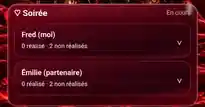

# LoveRoll — PREUVES VISUELLES ET BUGS
> Captures reçues le 26 octobre 2026. Elles montrent un **état constaté**, et non un correctif appliqué.

## LR-001 — D100 trop gros et coupé
**Écran :** onglet Soirée, mobile Android.
**Constat :** le haut du D100 est coupé au bord supérieur de son espace de rendu ; il est disproportionné par rapport au socle et aux boutons de sélection.

**Attendu :** dé entier, centré et réellement posé sur le socle, avec la proportion/caméra inspirée de l'onglet Surprise ; aucun chevauchement ni découpe pendant l'animation ; responsive mobile/tablette/PC.

## LR-003 — Calendrier et statuts
**Écran :** Calendrier, mobile Android, octobre 2026.
**Constat à investiguer :** « Soirée — En cours » tout en affichant « 0 réalisé · 2 non réalisés » pour chaque partenaire. Vérifier si « non réalisés » est une formulation attendue pendant que la soirée reste en cours ou s'il faut distinguer « à faire » / « non réalisé après clôture ». Ne pas présumer que le chiffre est faux sans inspecter les règles métier.

**Attendu :** états et compteurs cohérents entre cartes, calendrier, statistiques, historique et synchronisation.

### Notes pour Work
Les images sont des références du comportement initial. Les comparer aux captures après correction sur chaque format. Les fichiers WebP ci-dessus sont des reproductions compressées des captures fournies ; la conversation utilisateur contient les versions originales.
